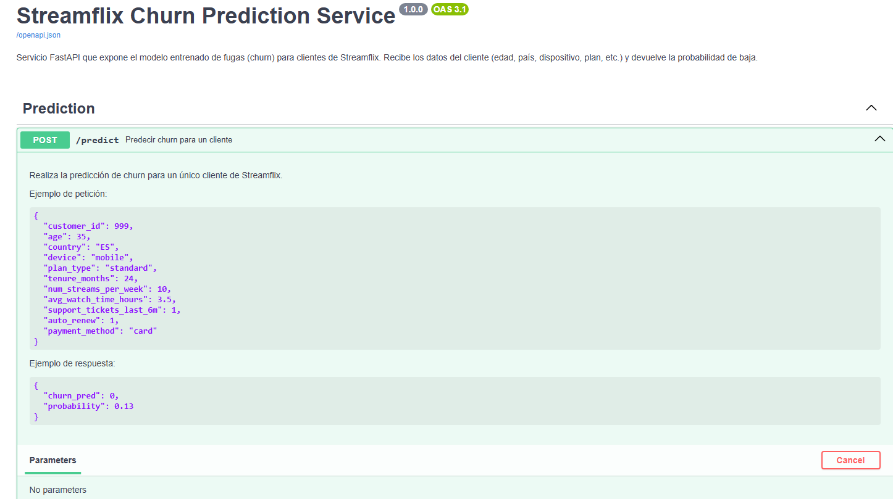
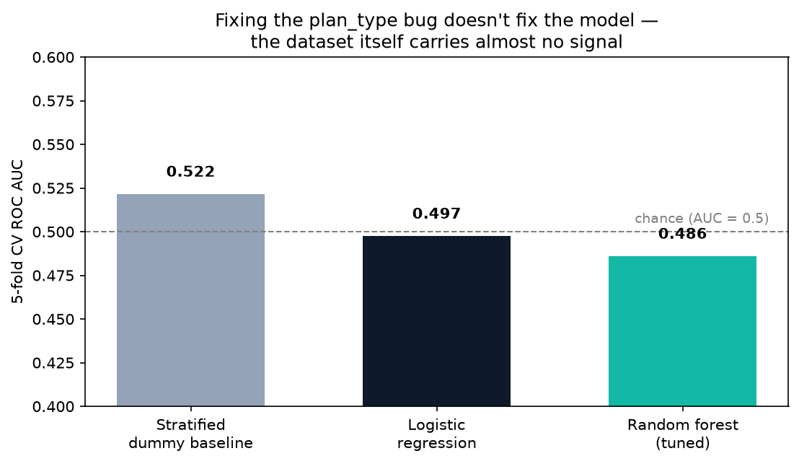
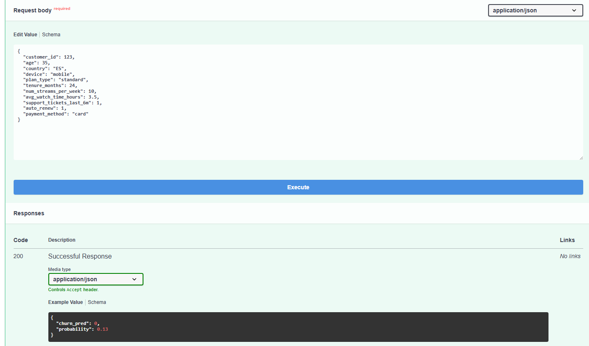

# Churn Prediction Service · scikit-learn + FastAPI

**A production-shaped ML service: trained pipeline, MLflow-ready metrics, and a FastAPI endpoint with auth, rate limiting and full input validation — plus two real bugs found and fixed along the way.**
Master's in Artificial Intelligence · UDIT · Programming Languages for AI (final exam, revisited) · 2026


> 🇪🇸 **Resumen:** servicio de predicción de bajas de clientes (churn) con un pipeline de scikit-learn y una API en FastAPI con autenticación por token, límite de peticiones y validación completa de datos. Revisión de un examen: se corrigieron dos fallos reales (una variable que nunca se usaba y una credencial por defecto en el código) y se añadieron 12 tests automáticos.

---

## What's inside

```
data → engineering (engagement) → sklearn pipeline (impute · scale · one-hot · RandomForest)
                                        │
                                        ├── results/metrics.json  (CV + test metrics)
                                        └── modelo_fuga.joblib + engagement_bounds.json
                                                        │
                                                        ▼
                                    FastAPI  /predict  /health
                                    ├── Bearer token auth
                                    ├── Rate limiting (slowapi)
                                    └── Pydantic validation (age, country, device, plan, payment method)
```

<p align="center">
  
</p>

## Two real bugs, fixed

The original exam pipeline had two defects that only show up when you actually try to run it:

1. **A silently dropped feature.** The feature list referenced `plan_time`, a column that doesn't exist in the dataset (the real column is `plan_type`) — so the customer's subscription tier never reached the model, without any error being raised.
2. **A hardcoded fallback API token** (`API_TOKEN = os.getenv("API_TOKEN", "supersecreto123")`). Any deployment that forgot to set the environment variable would silently run with a public, guessable credential. The service now **refuses to start** if `API_TOKEN` is not set.

*(A third, more subtle bug: the derived `engagement` feature was min-max normalised using the training set's own min/max — a single API request has no distribution to normalise against. Fixed by saving the training bounds to `engagement_bounds.json` and reusing them at inference time.)*

## Does fixing the bug fix the model?

No — and that's the honest, useful result:

<p align="center">
  
</p>

| | 5-fold CV AUC |
|---|---:|
| Stratified dummy baseline | 0.522 |
| Logistic regression | 0.497 |
| Random forest (tuned, `plan_type` included) | 0.486 |

With the bug fixed, the tuned random forest still doesn't beat a coin flip — it scores **below** the dummy baseline, a sign of overfitting to noise rather than a signal problem elsewhere. The synthetic dataset for this exam simply carries very little predictive signal for churn; the exam's own conclusion (~0.52 accuracy, "the dataset is not very informative") was directionally right even though the code that produced it had these bugs.

## API

<p align="center">
  
</p>

```bash
export API_TOKEN=choose-a-real-secret
uvicorn src.api:app --reload
```

```bash
curl -X POST http://127.0.0.1:8000/predict \
  -H "Authorization: Bearer $API_TOKEN" -H "Content-Type: application/json" \
  -d '{"age":35,"country":"ES","device":"mobile","plan_type":"standard","tenure_months":24,
       "num_streams_per_week":10,"avg_watch_time_hours":3.5,"support_tickets_last_6m":1,
       "auto_renew":1,"payment_method":"card"}'
# {"churn_pred":0,"probability":0.13}
```

Every field is validated by Pydantic (allowed countries, devices, plan tiers, payment methods; numeric ranges); malformed input returns `422`, not a crash. Wrong or missing token returns `401`.

## Tests

12 tests run the FastAPI app in-process (`TestClient`) against a model trained on synthetic data, so they don't depend on the real dataset:

```bash
pip install -r requirements.txt
export API_TOKEN=test-token
pytest tests/ -q
```

Covers: health check, missing/wrong token, valid prediction, six invalid-input cases (age out of range, unknown country/device/plan/payment method, non-positive watch time), a missing required field, and that importing the API without `API_TOKEN` set raises instead of falling back to a default.

## Reproduce training

```bash
python src/train_model.py     # writes modelo_fuga.joblib, engagement_bounds.json, results/metrics.json
python src/plot_results.py    # writes results/no_signal.png
```

The dataset is course material and is not published.

---

**María Tocado Murillo** · Applied AI & Data Scientist · [LinkedIn](https://www.linkedin.com/in/mar%C3%ADa-tocado-murillo/) · [GitHub](https://github.com/Maria-TM1)

© 2026 María Tocado Murillo. All rights reserved — see [LICENSE](LICENSE).
